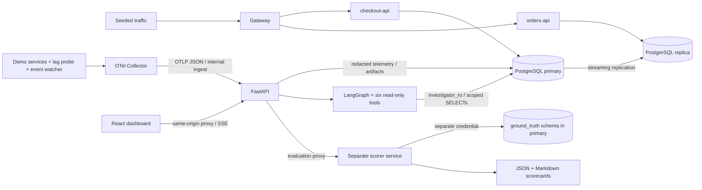

# AI Production Incident Investigator (AIPI)

A local incident investigation lab that turns OpenTelemetry logs, metrics, traces
and runtime events into scoped evidence, competing hypotheses and a cited report.
Deterministic correlation precedes a six-node LangGraph workflow; the default
reasoning adapter is a deterministic mock. The dashboard makes the evidence and
contradictions inspectable. No model key is needed.

## Architecture



## Quickstart

Requirements: **Python 3.12, uv, Node 25 with npm, Docker Desktop
running with Compose v2**, Git, and free loopback ports 5432, 5433, 8000, 8080,
5173, 4318 and 13133. Linux with Docker Engine/Compose also works as the CI target;
local verification was on Apple Silicon using native arm64 images. There is no
amd64 emulation setting. First builds/downloads take longer than the warm demo.

Use the isolated exports below if this host already has an `aipi` project or
`aipi_*` volumes, even when its containers are stopped. New credentials must not
be paired with retained volumes.

From a fresh clone (replace `<repository-url>` with this repository's URL or local
checkout path):

```sh
git clone <repository-url> aipi
cd aipi
make setup-env     # creates ignored .env, mode 0600, with random local credentials
make setup         # frozen uv workspace + npm ci; preserves an existing .env
make demo          # build/up, seed, kill/recover, incident, investigation, live eval + golden eval
```

`make demo` prints **Incident ID**, **UI URL**, the recovered chaos run ID, scores
and **Evaluation URL**. Open that UI URL to inspect the report. Default dashboard:
[localhost:5173](http://localhost:5173); API/OpenAPI:
[localhost:8000/docs](http://localhost:8000/docs).
Do not copy placeholder passwords into a running lab. Keep `.env` together with
its existing volumes; regenerating it will not update PostgreSQL role passwords.

For a second clone on the same machine, export these **before** the same
`make setup-env`, `make setup`, `make demo` commands:

```sh
export COMPOSE_PROJECT_NAME=aipi-fresh-check-$(date +%s)
export AIPI_DB_PORT=15432 AIPI_REPLICA_PORT=15433
export AIPI_API_PORT=18000 AIPI_GATEWAY_PORT=18080 AIPI_WEB_PORT=15173
export AIPI_COLLECTOR_PORT=14318 AIPI_COLLECTOR_HEALTH_PORT=23133
```

OpenAPI in this variant is http://127.0.0.1:18000/docs (the dashboard API reference
link uses the default API port). This uses separate project-prefixed images, networks
and named volumes. The watcher filters only that project's events. Open the printed URL (port 15173).
The host chaos scripts, recording, health checks and integration tests honor these
overrides. Generated host DB URLs in `.env` are defaults; host lab utilities use
the port overrides explicitly. For host Vite development on alternate ports use
`API_PROXY_TARGET=http://127.0.0.1:18000 npm run dev -- --port 15173` in apps/web.

## Five-minute demo

After dependencies/images are available:

1. Run `make demo` and wait for its verified recovery and passing scorecards.
2. Open the printed incident URL. Compare Facts, Hypotheses and Recommendations.
3. In Hypotheses, inspect FOR and AGAINST chips; follow an **outside bundle** chip.
4. Inspect Evidence payload/redactions, Timeline and the resumable Agent Trace.
5. Export Markdown. Open the printed Evaluation URL and reveal the scored label.

For the replica scenario run `make chaos-lag` and follow the window/service
instructions in [DEMO_GUIDE](docs/DEMO_GUIDE.md). Faults run serially; do not run
chaos, recording, tests or demos concurrently against one project.

## Commands

| Command | Behavior |
|---|---|
| `make up` / `make down` | Build/migrate/wait for health / stop containers, retain volumes |
| `make seed-traffic` | Seed 42 workload (default 1 cycle/s) |
| `make chaos-kill` / `make chaos-lag` | Fixed bounded fault, observable checks and recovery |
| `make investigate ID=<uuid>` | Start/poll investigation and print report |
| `make eval` | Recorded golden suite + poison fixture; JSON/Markdown in eval_reports/ |
| `make record-golden` | At least 3 new live faults per scenario; replace root fixtures, record variance |
| `make test` | Python unit/integration/golden and Vitest/RTL; start lab + traffic first |
| `make lint` / `make build-web` | Ruff, strict mypy, ESLint, tsc / Vite build |

When Docker is unavailable, Docker-marked tests skip. A reachable Docker daemon
with a stopped/broken lab fails tests. [Deployment](docs/DEPLOYMENT.md) covers
cleanup, troubleshooting and local CI checks. `make down` never removes volumes.

## Safety model

The safety model has six fixed read-only investigation tools with typed input,
parameterized queries and incident/service/time ScopePolicy enforcement.
`investigator_ro` cannot modify data or read `ground_truth`. The API supervisor
uses a separate restricted writer for artifacts/audits. The isolated scorer alone
gets the truth-reading credential; golden truth is stored separately in
`*.truth.json`. Agents receive observable evidence only. A distinct scorer-backed
Evaluation route reveals truth only after scoring, never through investigation
responses. Recommendations say **Requires human approval**, have
`requires_approval=true`, `executed=false`, and have no execution endpoint.
See [SECURITY](docs/SECURITY.md) for the threat model and socket caveat.

## Results

Measured on 2026-10-14, copied from [PROGRESS section 6](PROGRESS.md):
**deterministic mock on two curated scenarios, n=3 live runs each (6 total).
These are not LLM accuracy figures.**

| Metric | Actual |
|---|---|
| Root-cause Top-1 / Top-3 recall | 100% (6/6) / 100% |
| Evidence precision / coverage | 100% / 100% |
| Unsupported claim rate / critical unsupported claims | 0% / 0 |
| Contradiction handling / scripted recovery | 100% / 100% (6/6) |
| Median investigation latency (six runs) | 2.12955 s |
| Mutating investigation actions | 0 |

| Scenario (n=3) | Latency samples (ms) | Mean (ms) | Median (ms) | Stddev (ms) | Population variance (ms²) | Useful evidence/call mean | Efficiency variance |
|---|---|---|---|---|---|---|---|
| SCN-001 | 2633.48, 2074.76, 2184.33 | 2297.53 | 2184.33 | 241.73 | 58434.34 | 45.7500 | 7.072917 |
| SCN-002 | 2623.26, 877.35, 800.14 | 1433.58 | 877.35 | 841.82 | 708662.68 | 14.9630 | 0.068587 |

Misses: **none in those six measured runs**. Quality metric population variances
were zero. Mock token usage/cost is zero and per-token efficiency is null.
[Full samples and metadata](docs/verification/m5/live-summary.json) retain the
measured versions; later smoke runs do not replace this experiment.

## Limitations

- Mock-only results; two curated faults; no real-LLM measurements. Optional OpenAI
  and Anthropic adapters are unimplemented. Confidence uses a fixed evidence
  formula, never model self-confidence.
- The hallucination gate supports a bounded correlator/category claim vocabulary;
  it is not a general semantic judge or a production incident benchmark.
- No authentication/RBAC, TLS, queue or multi-worker job recovery. Keep the lab on
  loopback. Background jobs fail on process restart and can be resubmitted.
- The lab-only event watcher mounts docker.sock read-only and runs as root.
  **A read-only socket mount still permits Docker API control**; the watcher code
  only reads events. This is unsuitable for an untrusted/production deployment.
- GitHub CI **has not run**. Local actionlint and equivalent tests/build/smoke/
  full-history gitleaks are recorded in PROGRESS.md; they do not establish a hosted CI pass.

## Documentation

Current implementation docs: [Architecture](docs/ARCHITECTURE.md),
[API](docs/API.md), [Telemetry](docs/TELEMETRY.md),
[Evaluation](docs/EVALUATION.md), [Security](docs/SECURITY.md),
[Deployment](docs/DEPLOYMENT.md), [Decisions](docs/DECISIONS.md),
[Demo guide](docs/DEMO_GUIDE.md). [MIT license](LICENSE).
