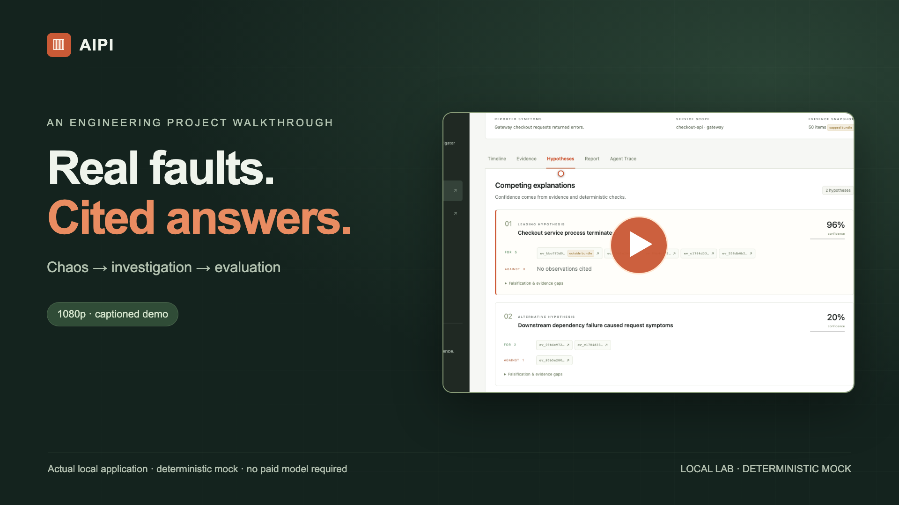
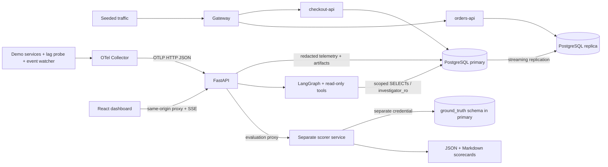
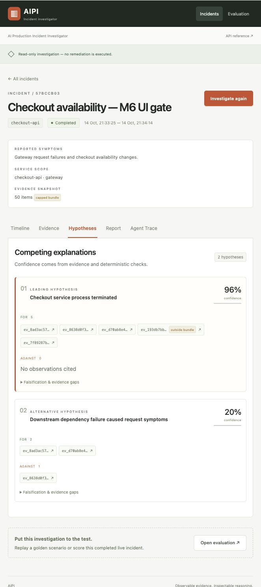

# AI Production Incident Investigator (AIPI)

A local incident investigation platform that connects OpenTelemetry signals to
ranked root-cause hypotheses and evidence-linked reports. It combines a real
Docker/PostgreSQL fault lab, a six-stage LangGraph workflow, a React dashboard
and an isolated evaluation service. The default reasoning adapter is a
**deterministic mock**: no model key or paid service is required.

## Demo video

[](demo/aipi-demo.mp4)

**86 seconds · 1080p H.264 · captioned.** A real checkout fault and recovery,
UI-created incident, scoped investigation, cited report and live evaluation.
Reasoning uses the deterministic mock; the displayed scores belong to that run.
Click the thumbnail to open the MP4, or download it for local playback.

Reproduce the workflow with `make demo` after setup.
[Recording commands, storyboard and verification](demo/README.md).

## Problem

Logs, metrics and traces often describe the same failure in different ways.
A timeout can be a symptom of a killed service or a delayed database replica.
AIPI makes those explanations testable: collect a bounded incident window,
preserve supporting and contradicting observations, and check the report against
known faults without exposing their labels to the investigator.

## Key features

- **Real fault experiments:** service SIGKILL/recovery and PostgreSQL replay pause,
  with observable failure signals and verified recovery.
- **Scoped evidence:** incident/service/time enforcement, immutable snapshots,
  stable source-derived IDs, metric summaries and deterministic selection.
- **Inspectable investigation:** six read-only tools, competing falsifiable
  hypotheses, FOR/AGAINST evidence and a fixed confidence formula.
- **Dashboard:** timeline, evidence filters, cited payloads, Markdown export and
  resumable server-sent agent/tool events.
- **Evaluation:** scorer-only ground truth, recorded and synthetic replay,
  citation/value checks, poison-fixture regression and JSON/Markdown scorecards.

This is an engineering lab with production-oriented boundaries, not a hardened
production deployment. Investigation tools never execute remediation.

## System architecture



The [architecture](docs/ARCHITECTURE.md) explains snapshot consistency, orchestration
and scoring; the [security model](docs/SECURITY.md) describes privilege boundaries.

## Technology stack

| Area | Implementation |
|---|---|
| API and data contracts | Python 3.12, FastAPI, Pydantic v2 |
| Storage and migrations | PostgreSQL 16 primary/replica, SQLAlchemy 2, Alembic, psycopg 3 |
| Investigation | LangGraph, deterministic correlators, BM25 runbook retrieval |
| Observability | OpenTelemetry SDK + Collector, structured logs, metrics, traces, runtime events |
| Dashboard | React 18, TypeScript, Vite, fetch-based SSE |
| Quality and packaging | uv, Ruff, strict mypy, pytest, Vitest/RTL, ESLint, Docker Compose, GitHub Actions |

## Quick start

Install **Python 3.12, uv, Node 25/npm, Git and Docker with Compose v2**. Start
Docker Desktop before running the lab. Apple Silicon uses native arm64 images;
there is no amd64 emulation override. Default loopback ports are 5432, 5433,
8000, 8080, 5173, 4318 and 13133.

```sh
git clone https://github.com/Akshat5249/AIPI.git aipi
cd aipi
make setup-env     # create ignored .env with random local credentials (0600)
make setup         # frozen Python workspace + npm ci; preserve existing .env
make demo          # build, start, seed, inject/recover, investigate and evaluate
```

The demo prints the **Incident ID**, **UI URL** and **Evaluation URL**. Defaults:
[dashboard](http://localhost:5173), [OpenAPI](http://localhost:8000/docs).
First dependency downloads and image builds take longer than a warm demo.
`.env.example` is a reference containing placeholders; use `make setup-env` to
create actual local credentials. Keep an existing `.env` paired with its volumes.

If this machine already has an `aipi` project or `aipi_*` volumes, use a separate
project even if those containers are stopped. Export these **before** running the
same setup/demo commands in the new clone; check that these ports are free:

```sh
export COMPOSE_PROJECT_NAME=aipi-public-check-$(date +%s)
export AIPI_DB_PORT=15432 AIPI_REPLICA_PORT=15433
export AIPI_API_PORT=18000 AIPI_GATEWAY_PORT=18080 AIPI_WEB_PORT=15173
export AIPI_COLLECTOR_PORT=14318 AIPI_COLLECTOR_HEALTH_PORT=23133
```

Keep these exports active for subsequent commands. Images, networks, volumes,
host tools and watcher filters use that project. Open the printed UI URL;
OpenAPI is then [127.0.0.1:18000/docs](http://127.0.0.1:18000/docs). The dashboard's
API-reference link currently uses the default port. For host Vite development,
set `API_PROXY_TARGET=http://127.0.0.1:18000` when running `npm run dev` in `apps/web`.

## Reproduce the demo

After setup, a warm walkthrough takes approximately five minutes:

1. Run `make demo`. It collects a 30-second baseline, kills/restarts checkout-api,
   creates a scoped incident, runs the investigation and scores the recovered fault.
2. Open the printed incident URL. Compare Facts, Hypotheses and Recommendations.
3. Open FOR/AGAINST citations, including an **outside bundle** item; inspect the
   source payload, redactions and timeline.
4. Inspect Agent Trace and export the report as Markdown.
5. Open the printed Evaluation URL to inspect scores and the post-score label.

[Replica-lag walkthrough](docs/DEMO_GUIDE.md) ·
[Captured dashboard](docs/images/README.md)

<details>
<summary>View a captured hypotheses screen</summary>



Captured from the real local mock walkthrough on 2026-10-14. Screenshots retain
the original incident titles and IDs; they are examples, not a hosted deployment.

</details>

Run faults, demos, recording and live tests serially against each project.
`make down` stops its containers and retains all named volumes.

## Testing and validation

With the lab and traffic running:

```sh
make test          # pytest unit/integration/golden + Vitest/React Testing Library
make lint          # Ruff lint/format, strict mypy, ESLint and TypeScript
make eval          # recorded goldens + poisoned-log gate; no model credentials
make build-web     # production frontend compilation
```

For Python checks without a running lab, use `uv run pytest -m 'not docker'`.
Docker-marked tests skip only if the daemon is unavailable; a reachable but broken
lab fails. Tests exercise both real faults, scoped lookup, DB grants, report
citations, SSE and evaluation. Negative tests require evaluation failure for an
unknown evidence ID, a fabricated metric value and a wrong root cause.

The [CI workflow](.github/workflows/ci.yml) defines lint/types, unit/golden/live
integration, the hallucination gate, image builds, Compose health and full-history
gitleaks. **GitHub CI has not run**; local validation does not establish a hosted
pass. See [deployment and troubleshooting](docs/DEPLOYMENT.md) for commands.

## Technical highlights

- Correlators run on the full scoped snapshot **before** the 50-item display cap.
  Raw supporting witnesses remain resolvable through incident-scoped evidence lookup.
- Evidence IDs derive from `sha256(type + "|" + source_ref)`; frozen snapshots and
  database triggers preserve replay consistency despite later telemetry arrivals.
- The six tools use `investigator_ro`. A separate supervisor writes artifacts;
  only the scorer receives the truth-reading credential. Ground truth never enters
  investigation inputs. Recommendations require human approval and have no execution API.
- Pydantic validates graph state and reports. Invalid citations get one repair;
  further failure stops the report. Confidence comes from evidence features and
  contradiction penalties, never model self-confidence.

Measured on Apple Silicon on **2026-10-14**, using the **deterministic mock on two
curated scenarios, n=3 live runs each**. These are regression results, **not LLM
accuracy figures**, load benchmarks or demonstrated reductions in incident response time.

| Metric | Observed across six runs |
|---|---|
| Root-cause Top-1 / Top-3 recall | 100% (6/6) / 100% |
| Evidence precision / coverage | 100% / 100% |
| Unsupported claim rate / critical unsupported claims | 0% / 0 |
| Contradiction handling / scripted recovery | 100% / 100% |
| Median investigation latency | 2.12955 s |

No misses occurred in those six runs. [Raw samples, experiment metadata and
per-scenario variance](docs/results/README.md) preserve the measurement conditions;
new smoke runs do not replace that experiment.

## Limitations and future improvements

- Only two curated faults and mock reasoning are measured. OpenAI/Anthropic
  adapters are unimplemented; provider comparisons and broader scenario coverage
  remain future work.
- The hallucination gate checks a bounded claim vocabulary, not general
  natural-language entailment. Confidence weights are not broadly calibrated.
- No authentication/RBAC, TLS, durable queue, multi-worker recovery or automatic
  telemetry retention. Keep the lab on loopback; production use requires these.
- The lab event watcher runs as root with a read-only `docker.sock` mount.
  **That mount still permits Docker API control** and is unsuitable for an
  untrusted deployment. A production design needs a safer event source.
- Hosted GitHub CI and real-LLM robustness remain unverified. No deployment or
  autonomous remediation capability is claimed.

[Documentation index](docs/INDEX.md): architecture, API, telemetry, evaluation,
security, deployment, ADRs and the demo guide.

## License

[MIT](LICENSE).
